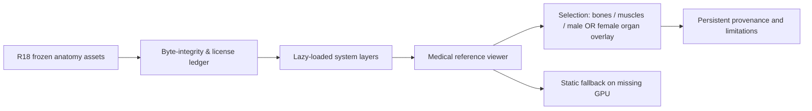
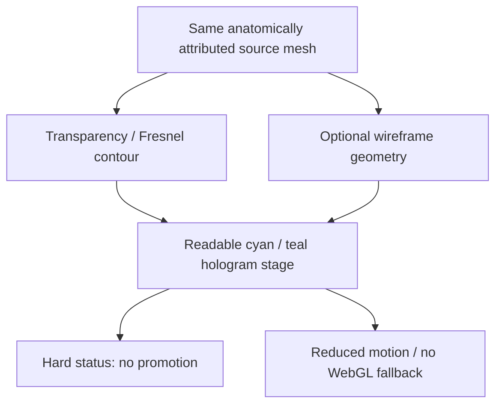
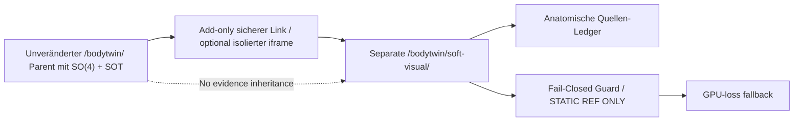

# R19 · Drei visuelle und technische Blaupausen (DESIGN ONLY)
Sämtliche Darstellungen sind **Zielentwürfe**, keine Browser-Screenshots, klinischen Modelle oder verifizierten Live-Ansichten.

## Blueprint A — Layered Anatomical Atlas

**Bühne:** neutraler dunkelblauer Hintergrund; knochenfarbenes Skelett; differenziertes Muskelrot; Organe als selektiv halbtransparente Labels; Ansicht frontal, dorsal, lateral; scharfe Legende, kein Smart-Diagnosis Label.
**Interaktionen:** Layers toggles, search FMA/UBERON, isolate selected anatomical item, camera orbit/zoom; organ toggle is exactly NONE|MALE|FEMALE and does not change male BP3D base.
**Falsifier:** Female mode must never show the words "complete female corpus", when only HRA female organs overlay the male skeleton.

## Blueprint B — Hologram / Laser vector

**Bühne:** gedimmter schwarzer Raum, medizinische Silhouette als Mesh mit Lichtkonturen und feinen Scanlines, mehrere Layer erscheinen in gestaffelten Tiefen. **Kein realer Laser, keine Volumenprojektion.** Höhere Renderkosten dürfen nicht zulasten mobiler Zugänglichkeit gehen.
**Interaktionen:** 3D-Drehung, Layer Depth, Highlight, Freeze view, wireframe; Bloom default OFF für Low-End.
**Falsifier:** Ein vom Rendering generierter Status darf keine Behauptung über physische Sensorobservabillität oder klinische Daten enthalten.

## Blueprint C — Dual-Pane Symbiotic Bodytwin

**Bühne:** links bestehende mathematische Gitter-/SO(4)-Projektion, rechts anatomischer Korpus als informative Referenz. Technisch zwei isolierte Zustandsflächen und ausdrücklich getrennte epistemische Rollen.
**Interaktionen:** Wechsel zwischen abstrahierter Projektion und Anatomie; keine Rückschreibung von Soft in Hard/Status.
**Falsifier:** Weder iframe noch Hook dürfen Original-SO(4)-Inputs, Live Feed, Cron, Status oder Deploypfad überschreiben.

## Rendering- und Fehlermodus-Matrix
| Modus | Erwartete technische Inputs | Pflichtstatus |
|---|---|---|
| static skeleton | Skeleton layer, GPU or snapshot | ANATOMICAL_REFERENCE_ONLY |
| muscles | Muscle layer, skeleton reference | NON_MEDICAL_VISUAL |
| organs male | one VH male HRA group | ORGANS_MALE_REFERENCE |
| organs female | one VH female HRA group on male BP3D base | FEMALE_ORGANS_NOT_FULL_FEMALE_BODY |
| hologram | same source mesh IDs + shader | VISUAL_EFFECT_ONLY |
| IMU segment future | separately measured segment with calibration, reliability | NOT_CURRENTLY_AUTHORIZED |
| sensor dropout | no inferred pose, reference pose | FAIL_CLOSED |
| no GPU | PNG/SVG and provenance | FALLBACK_REFERENCE |

## Geometrische Verträge
BP3D `millimetres + Z-up` → expliziter `T_BP3D_to_GLTF` → glTF `metres + Y-up`; HRA `metres + Y-up` → `T_HRA_to_scene`; source-scale, axis convention, rigid transform and source identity as metadata. Nicht als medizinisch präzise Registrierung behaupten. 23 Gait2392 DOF = Orientierungs-/Limitreferenz, **kein** automatisches Skinning. R18 Shader-GPU-Qualifikation offen.

## Visueller Begriffskanon
Beschriftungen: "Anatomische Referenz", "Hologramm-Modus (Software)", "Männliche Referenzbasis", "Weibliche Organreferenz, keine weibliche Gesamtreferenz", "C1_DESCRIPTIVE_ONLY", "Sensorstatus nicht inferiert", "WebGL nicht verfügbar – statisches Referenzbild".
